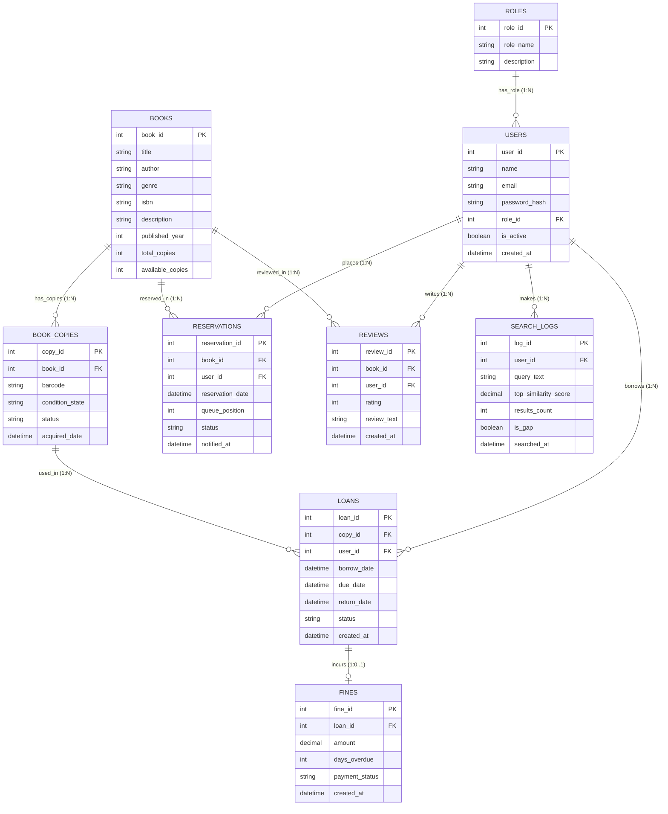

# LibraSearch - Entity-Relationship (ER) Model Specification

## 1. Overview of Diagram Assets

The complete visual database models are available as native Draw.io files:

- **Chen Notation ER Diagram:** [`er-diagram.drawio`](./drawio/er-diagram.drawio)
- **Relational Schema:** [`relational-schema.drawio`](./drawio/relational-schema.drawio)
- **Physical Relational Tables:** [`relational-tables.drawio`](./drawio/relational-tables.drawio)
- **Master Consolidated File:** [`librasearch-database-design.drawio`](./drawio/librasearch-database-design.drawio) (Contains all three diagrams in selectable tabs)

---

## 2. Entity Dictionary & Structural Attributes

### 2.1 ROLES
Represents administrative authorization tiers within the system.
- `role_id` (Primary Key): Unique numeric identifier.
- `role_name`: Unique system role tag (`MEMBER`, `LIBRARIAN`).
- `description`: Scope and access privileges of the assigned role.

### 2.2 USERS
Represents registered library patrons, staff librarians, and administrators.
- `user_id` (Primary Key): Unique patron identifier.
- `name`: Full legal name.
- `email`: Unique contact and login identifier.
- `password_hash`: Cryptographically hashed credential (Argon2id).
- `role_id` (Foreign Key -> `ROLES.role_id`): Authority assignment.
- `is_active`: Account standing boolean flag (`TRUE` = Active, `FALSE` = Suspended).
- `created_at`: Account registration timestamp.

### 2.3 BOOKS
Represents catalog bibliographic master records.
- `book_id` (Primary Key): Unique title identifier.
- `title`: Complete title string.
- `author`: Primary author name.
- `genre`: Primary literary genre classification.
- `isbn`: Unique 13-digit International Standard Book Number.
- `description`: Textual plot synopsis and thematic summary.
- `published_year`: Year of initial publication.
- `total_copies`: Total count of physical inventory copies owned by the library.
- `available_copies`: Current count of physical copies ready for immediate borrowing on shelves.

### 2.4 BOOK_COPIES
Represents distinct physical units of a book title tracked in library inventory.
- `copy_id` (Primary Key): Unique physical copy serial number.
- `book_id` (Foreign Key -> `BOOKS.book_id`): Reference to parent title.
- `barcode`: Scannable item barcode sticker.
- `status`: Circulation state (`AVAILABLE`, `BORROWED`, `RESERVED`, `DAMAGED`, `LOST`).
- `condition_state`: Physical condition assessment (`NEW`, `GOOD`, `FAIR`, `WORN`).
- `acquired_date`: Date asset was processed into collection.

### 2.5 LOANS
Represents circulation transactions between patrons and physical inventory items.
- `loan_id` (Primary Key): Unique circulation record identifier.
- `copy_id` (Foreign Key -> `BOOK_COPIES.copy_id`): Specific physical copy checked out.
- `user_id` (Foreign Key -> `USERS.user_id`): Borrower identifier.
- `borrow_date`: Timestamp of checkout.
- `due_date`: Prescribed return deadline (default 14 days).
- `return_date`: Timestamp when copy was checked in (`NULL` while active).
- `status`: Circulation status (`ACTIVE`, `RETURNED`, `OVERDUE`).
- `created_at`: Record creation timestamp.

### 2.6 RESERVATIONS
Represents first-in, first-out (FIFO) hold requests placed on checked-out titles.
- `reservation_id` (Primary Key): Unique reservation queue identifier.
- `book_id` (Foreign Key -> `BOOKS.book_id`): Title placed on hold.
- `user_id` (Foreign Key -> `USERS.user_id`): Patron waiting in queue.
- `reservation_date`: Timestamp when hold was submitted.
- `queue_position`: Sequential rank in the reservation line.
- `status`: Reservation state (`PENDING`, `FULFILLED`, `CANCELLED`, `EXPIRED`).
- `notified_at`: Timestamp when patron was notified of item availability.

### 2.7 FINES
Represents monetary penalties incurred due to overdue book returns.
- `fine_id` (Primary Key): Unique financial assessment identifier.
- `loan_id` (Foreign Key -> `LOANS.loan_id`): Associated overdue loan.
- `amount`: Assessed fee calculated at standard daily rate.
- `days_overdue`: Total calendar days returned past due date.
- `payment_status`: Settlement state (`UNPAID`, `PAID`, `WAIVED`).
- `created_at`: Fine issuance timestamp.

### 2.8 REVIEWS
Represents qualitative feedback and numerical ratings submitted by patrons.
- `review_id` (Primary Key): Unique review identifier.
- `book_id` (Foreign Key -> `BOOKS.book_id`): Title reviewed.
- `user_id` (Foreign Key -> `USERS.user_id`): Author of review.
- `rating`: Integer evaluation on a scale of 1 to 5 stars.
- `review_text`: Detailed qualitative patron commentary.
- `created_at`: Review submission timestamp.

### 2.9 SEARCH_LOGS
Represents patron search queries utilized to drive the Acquisition Gap Engine.
- `log_id` (Primary Key): Unique search event identifier.
- `user_id` (Foreign Key -> `USERS.user_id`, Nullable): Patron if authenticated, `NULL` for guest queries.
- `query_text`: Raw query string submitted by reader.
- `top_similarity_score`: Highest cosine similarity score returned by Qdrant.
- `results_count`: Number of catalog matches returned above threshold.
- `is_gap`: Boolean flag (`TRUE` if `top_similarity_score < 0.65`, signaling unmet catalog demand).
- `searched_at`: Search timestamp.

---

## 3. Relationship Specifications & Structural Constraints

| Relationship | Entities Involved | Cardinality Ratio | Participation Constraint | Business Rule & Semantic Meaning |
| :--- | :--- | :--- | :--- | :--- |
| **`has_role`** | `ROLES` (1) to `USERS` (N) | 1 : N | `USERS`: Total `ROLES`: Partial | Every user must be assigned exactly one role; a role can govern many users. |
| **`borrows`** | `USERS` (1) to `LOANS` (N) | 1 : N | `LOANS`: Total `USERS`: Partial | A loan must belong to one registered user; an active user may borrow multiple books over time. |
| **`used_in`** | `BOOK_COPIES` (1) to `LOANS` (N) | 1 : N | `LOANS`: Total `BOOK_COPIES`: Partial | A loan specifies exactly one physical item copy; a copy can be loaned repeatedly across its lifecycle. |
| **`has_copies`** | `BOOKS` (1) to `BOOK_COPIES` (N) | 1 : N | `BOOK_COPIES`: Total `BOOKS`: Partial | Every physical copy belongs to one bibliographic book title; a title can have multiple physical copies. |
| **`places`** | `USERS` (1) to `RESERVATIONS` (N) | 1 : N | `RESERVATIONS`: Total `USERS`: Partial | A reservation is placed by one user; a user may hold reservations for different unavailable titles. |
| **`reserved_in`**| `BOOKS` (1) to `RESERVATIONS` (N) | 1 : N | `RESERVATIONS`: Total `BOOKS`: Partial | A reservation references one specific title; a popular title can accumulate a queue of holds. |
| **`incurs`** | `LOANS` (1) to `FINES` (0..1) | 1 : 1 (or 1 : 0..1) | `FINES`: Total `LOANS`: Partial | An overdue loan incurs at most one fine record; on-time loans incur zero fines. |
| **`writes`** | `USERS` (1) to `REVIEWS` (N) | 1 : N | `REVIEWS`: Total `USERS`: Partial | A review is authored by one patron; a patron may review many distinct titles they have borrowed. |
| **`reviewed_in`**| `BOOKS` (1) to `REVIEWS` (N) | 1 : N | `REVIEWS`: Total `BOOKS`: Partial | A review evaluates one book; a book can accumulate numerous reader reviews. |
| **`makes`** | `USERS` (1) to `SEARCH_LOGS` (N) | 1 : N | `SEARCH_LOGS`: Partial `USERS`: Partial | A search query can be logged to a known patron or recorded anonymously if unauthenticated. |

---

## 4. Visual Mermaid ER Representation

